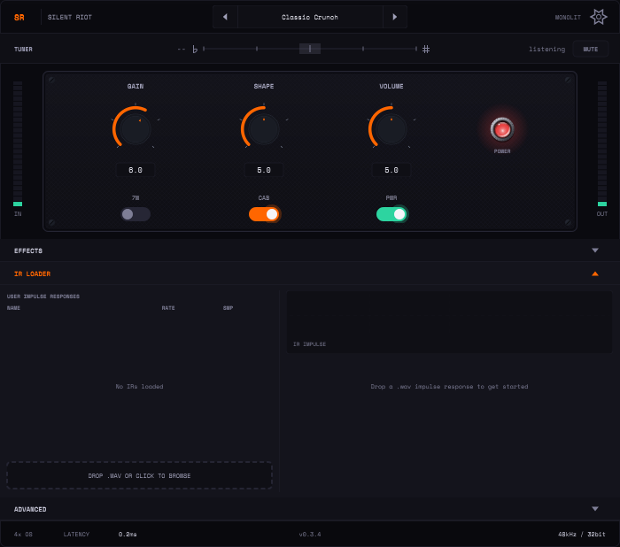
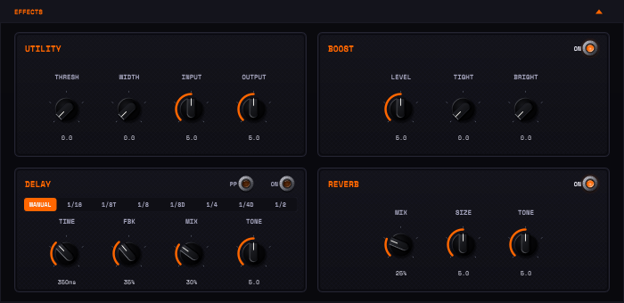

# Silent Riot

**Silent Riot** is a free, open-source guitar amp simulator (VST3 and Standalone) built
around one original amplifier design: two 12AX7 preamp stages, a long-tail-pair phase
inverter and a push-pull pair of EL84 power tubes. It has three knobs (GAIN, SHAPE,
VOLUME) and a 15W/7W switch. The amp is modelled stage by stage, including the power
supply, cathode sag and grid conduction, so it cleans up when you play softly, sags when
you dig in, and gets its feel from the circuit rather than from a fixed curve.



> **Status: pre-1.0.**
> - The tone is still being calibrated, so a sound you save today may change slightly
>   in a later build.
> - There are no bundled speaker IRs yet. Use the built-in filter cabinet, or load your
>   own impulse responses.
> - Windows and Linux, VST3 and Standalone. No macOS or AU yet.
> - No release has been tagged yet. Releases will appear on the GitHub Releases page;
>   until then, build from source (below).

## Features

- **One amp, modelled in depth.** Koren tube models for every stage, an asymmetric
  long-tail-pair phase inverter, a cathode-biased EL84 push-pull output, and a power
  supply that droops and sags under load.
- **Three controls that interact like a real amp.** GAIN sets the preamp drive. SHAPE
  sweeps from warm and mid-forward to scooped. VOLUME drives the power stage, so it
  changes the feel as well as the level.
- **15W / 7W** power modes.
- **Cabinet:** a built-in filter cab, or your own WAV impulse responses, level-matched
  so switching between them doesn't jump in loudness.
- **Effects:** noise gate, stereo width, input/output trims, boost, tempo-syncable
  delay and spring reverb.
- **Always-on tuner** on the DI input. It still works with the amp muted.
- **Oversampling** at 2×, 4× or 8×, with an exact latency reported to the host.



## Install

There are no prebuilt downloads yet (see Status). Once you have a build, from source or
from a future release:

| OS | VST3 goes in | Standalone |
|---|---|---|
| Linux | `~/.vst3/` (per user) or `/usr/lib/vst3/` | run the `Silent Riot` binary |
| Windows | `C:\Program Files\Common Files\VST3\` | run `Silent Riot.exe` |

Then insert it on a mono or stereo guitar track. The [manual's quick start](docs/manual/README.md#quick-start)
covers input level and a first tone.

## Build from source

On Ubuntu:

```bash
./scripts/install-deps.sh     # build dependencies, once
./scripts/build.sh release    # Release build
bash scripts/verify.sh        # optional: static checks + the full test suite
```

JUCE and Catch2 are fetched automatically. Windows (MSVC), CMake options and output
paths are covered in [docs/dev/building.md](docs/dev/building.md).

## Documentation

| Where | What |
|---|---|
| [User manual](docs/manual/README.md) | Controls, effects, cabinets and IRs, presets and settings, tuner, automation parameters |
| [Developer docs](docs/dev/) | [Building](docs/dev/building.md), [testing](docs/dev/testing.md), [architecture](docs/dev/architecture.md), [tone sign-off](docs/dev/tone-signoff.md) |
| [Docs index](docs/README.md) | Every document, and whether it is current or a dated record |
| [CHANGELOG.md](CHANGELOG.md) | What changed, in player terms |
| [ROADMAP.md](ROADMAP.md) | The plan to 1.0 |

## Contributing

Bug reports, tone feedback and focused fixes are welcome. Read
[CONTRIBUTING.md](CONTRIBUTING.md) first: every change passes `bash scripts/verify.sh`
and comes with a test. If something sounds wrong, the **Tone feedback** issue form asks
for your settings and a short DI clip, which is what makes a report actionable.

This project follows a [Code of Conduct](CODE_OF_CONDUCT.md). Please report
vulnerabilities privately as described in [SECURITY.md](SECURITY.md).

## Support

Optional donations are planned; the project will always be free, with no gated features.

## Licence and credits

Copyright © 2026 Boris Miscenco (Monolit Beatz).
Licensed under the GNU General Public License v3 or later; see [LICENSE](LICENSE).

The DSP is original work. The tube models use the published Koren equations with
datasheet parameters, and no code is taken from other amp simulators.
[CREDITS.md](attribution/CREDITS.md) has the full statement and the third-party licences: JUCE
(GPLv3), and the Oxanium font (SIL Open Font License 1.1).
Silent Riot is built with AI-assisted implementation under the author's design, direction and
review; [AI_USAGE.md](attribution/AI_USAGE.md) sets out the scope.
