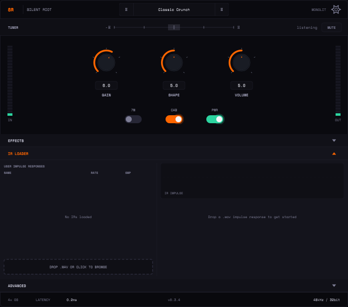

# Silent Riot — User Manual

Silent Riot is a guitar amp simulator: one amplifier, modelled stage by stage. Two
12AX7 preamp stages feed a long-tail-pair phase inverter and a push-pull pair of
EL84 power tubes, with a power supply that sags when you dig in. Three knobs
(GAIN, SHAPE, VOLUME) run the amp; an EFFECTS section, a cabinet IR loader and a
live tuner sit around it. It runs as a VST3 plugin or as a standalone app.



> **Status: pre-1.0.** The tone is still being calibrated, so a sound you save
> today may change slightly in a later build. The built-in cabinet is a filter
> model; there are no bundled speaker IRs yet, so load your own for the most
> realistic cab sound ([Cabinets and IRs](cabinets-and-irs.md)).

## Pages

| Page | What it covers |
|---|---|
| [Controls](controls.md) | GAIN, SHAPE, VOLUME, 7W, CAB, PWR, oversampling, meters |
| [Effects](effects.md) | UTILITY (gate, width, input/output trims), BOOST, DELAY, REVERB |
| [Cabinets and IRs](cabinets-and-irs.md) | The built-in cab, loading impulse responses, their limits |
| [Presets and settings](presets-and-settings.md) | Factory presets, the settings panel, what is saved with a project |
| [Tuner](tuner.md) | The always-on tuner and its mute |

Each page ends with a table of its **parameters** — the ID and name your host
shows for automation, the range and the default.

## Quick start

1. **Load it.** Install the VST3 (`Silent Riot.vst3`) into your host's VST3
   folder — `~/.vst3` on Linux, `C:\Program Files\Common Files\VST3` on
   Windows — and insert it on a mono or stereo guitar track. Or run the
   standalone app and pick your audio interface under **Options → Audio/MIDI
   Settings**. To build it yourself, see [Building](../dev/building.md).
2. **Set your input level.** Play hard and watch the **IN** meter on the left.
   The amp responds to how hard you hit it, so a level that is too low makes
   every GAIN setting sound cleaner than it should. Aim for a DI peaking around
   −12 to −6 dBFS in your interface; if you can't change the interface gain, use
   the **INPUT** trim in EFFECTS → UTILITY (±12 dB).
3. **Dial a tone.** Start at GAIN 6, SHAPE 5, VOLUME 5 (the defaults).
   - Cleaner: GAIN down. Dirtier: GAIN up.
   - More mids and push: SHAPE counter-clockwise. Scooped and modern: clockwise.
   - VOLUME drives the power tubes, not just the loudness — turn it up for more
     sag, compression and power-amp breakup ([Controls](controls.md#volume)).
4. **Set the output level** with the **OUTPUT** trim (EFFECTS → UTILITY) or your
   host's fader. OUTPUT is after the amp, so it changes level, never tone.
5. Want a starting point? Step through the factory presets with the arrows in
   the header ([Presets](presets-and-settings.md)).

## Keyboard

Click a knob, then use **arrow keys** to move it by 0.1 on its 0–10 scale or
**Page Up / Page Down** to move it by 1. **Tab** moves between the controls.
Double-click a knob to return it to its default.

## Signal flow

```
Guitar → INPUT trim → Gate → Boost → Preamp (GAIN) → Phase inverter → SHAPE
      → VOLUME → EL84 power amp ⇄ power supply sag → Output transformer
      → Cabinet (built-in or IR) → Delay → Reverb → Width → OUTPUT trim → Out
```

The tuner listens to the raw input, before everything above.
