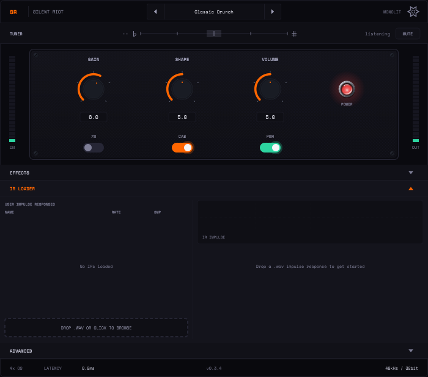
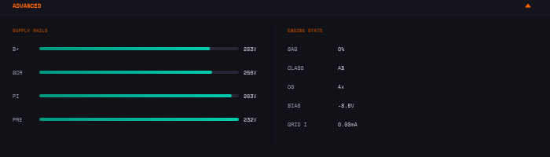

# Controls

The amp section: three knobs, three switches, the level meters and the footer.

Knobs read **0–10** on screen; hosts see the same knob as **0–1** (knob 5 =
0.5). Double-click a knob to reset it.

## GAIN

Preamp drive: how hard the two 12AX7 stages and the phase inverter are pushed.
Low settings stay clean and dynamic; past the middle the preamp breaks up, and
near the top the phase inverter starts to clip as well, which thickens the
distortion and compresses the attack.

The knob is tapered so its travel is spread evenly by ear. The amp reacts to
your input level too — picking softer cleans it up at any GAIN setting — so set
your input level first ([Quick start](README.md#quick-start)).

## SHAPE

A three-band tone control after the phase inverter, in the spirit of Orange's
Shape knob. One knob sweeps three filters together:

| SHAPE | Lows (250 Hz) | Mids (800 Hz) | Highs (3.5 kHz) | Character |
|---|---|---|---|---|
| 0 (fully CCW) | 0 dB | +5 dB | −3 dB | warm, mid-forward, pushes through a mix |
| 5 (noon) | +2 dB | −2 dB | +0.5 dB | mild scoop |
| 10 (fully CW) | +4 dB | −9 dB | +4 dB | scooped, modern |

The gains move in a straight line between those points.

## VOLUME

The master volume — but on this amp it sits **in front of the power tubes**, so
it is really the **power-stage drive** control, as on a real non-master-volume
EL84 amp:

- Low VOLUME: the power tubes run clean, the amp is tight and stays out of the
  way of the preamp's tone.
- Turning it up: more power-tube saturation, more **sag** (the supply voltage
  drops as you play hard and recovers when you let a chord ring), more give and
  bloom on the attack.

VOLUME does change loudness, but use the **OUTPUT** trim (EFFECTS → UTILITY) or
your host fader to set the final level, and VOLUME to set how much the power
section works.

## 7W

Half-power mode. Switches the EL84 bias from −9.6 V (15 W) to a hotter −7 V
(7 W): the power tubes overlap more, so breakup comes earlier and softer and the
amp feels spongier. Switching it while playing makes the power section re-settle
for a moment, which you may hear.

## CAB

Cabinet simulation on/off.

- **On** (default): the amp plays through the built-in cabinet model, or through
  your impulse response if one is selected in the IR LOADER
  ([Cabinets and IRs](cabinets-and-irs.md)). Turning CAB on also opens the IR
  LOADER panel.
- **Off**: the raw power-amp output with no speaker. Use it when you run your
  own cab-sim plugin or IR loader after Silent Riot.

Switching between modes fades over a few milliseconds, so it does not click.

## PWR

Amp power. Off silences the plugin (both meters drop to zero) but the
[tuner](tuner.md) keeps working. Switching it back on clears the delay and
reverb tails, so nothing from before power-off replays.

## Meters

The **IN** meter (left) shows the input after the INPUT trim; the **OUT** meter
(right) shows the final output after the OUTPUT trim. Ballistics and peak hold
are set in [Settings](presets-and-settings.md#settings).

## Footer

Shows the oversampling factor, the plugin's latency, the session sample rate and
bit depth.

## Oversampling

The amp runs at 2×, 4× (default) or 8× the session sample rate to keep
distortion harmonics from folding back as aliasing. Higher costs more CPU.
There is no on-screen switch: change it from your host's parameter list or
automation (**Oversample**). The change crossfades, and the reported latency
updates (10 samples at 2×, 12 at 4× and 8×).

## Advanced panel

A read-only view of the model's state: the supply rails (B+, screen, phase
inverter, preamp, in volts) dropping as the amp sags, the sag amount, whether
the power mode's class (CLASS reads A in 7W and AB in 15W — a label for the
mode's voicing, not a measurement), the oversampling factor, the effective
EL84 bias and the power-tube grid current (GRID I normally reads 0: the
power-tube grids don't conduct in ordinary playing).

## Parameters

| ID | Host name | Range | Default |
|---|---|---|---|
| `gain` | Gain | 0–1 | 0.6 |
| `tone` | Shape | 0–1 | 0.5 |
| `volume` | Volume | 0–1 | 0.5 |
| `halfPower` | 7W Mode | off / on | off (15 W) |
| `cabSim` | Cab Sim | off / on | on |
| `power` | Power | off / on | on |
| `oversample` | Oversample | 2x / 4x / 8x | 4x |
