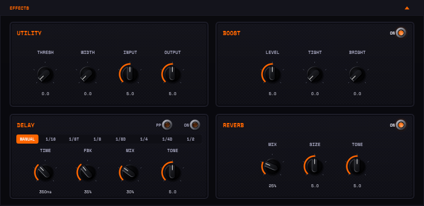

# Effects

Open the **EFFECTS** bar under the amp to show three cards: BOOST, DELAY and
REVERB. The noise gate, the stereo widener and the INPUT/OUTPUT trims are not in
the panel: they sit beside the level meters, either side of the amp. Everything
here is off or neutral by default, and an effect that is off is skipped completely —
it costs nothing and does not touch the sound.



Where they sit in the chain:

```
INPUT trim → Gate → Boost → [ amp + cab ] → Delay → Reverb → Width → OUTPUT trim
```

The gate and boost are in front of the amp, like pedals on the floor; delay and
reverb come after the cabinet, like a studio effects send.

## Beside the meters

Four knobs with no on/off switch, each neutral at its default: **INPUT** over
**THRESH** next to the IN meter (left), **OUTPUT** over **WIDTH** next to the
OUT meter (right).

### THRESH — noise gate

A downward expander in front of the amp that quietens hiss and hum between
notes. The knob sets the threshold from −80 dB (0, gate off) to −20 dB (10,
aggressive). It opens in about 1 ms and closes over about 80 ms, with 4 dB of
hysteresis so a decaying note doesn't chatter. Start low and raise it until the
noise between phrases goes away; too high cuts off note tails.

### WIDTH — stereo widener

The last stage before OUTPUT, on stereo tracks only (it does nothing on a mono
bus). 0 is off; turning it up widens the sound like a double-tracked part: it
raises the stereo side signal and adds a slightly delayed, gently detuned copy
to the sides. Your mix stays **mono-compatible** at every setting — summing to
mono gives back exactly the centre signal — and it never narrows a sound that
is already wide.

### INPUT and OUTPUT — level trims

Gain staging, not tone controls. Both are unity (no change) at 5.

- **INPUT**: −12 dB (0) to +12 dB (10), applied before everything else. Use it
  to match your pickups and interface so GAIN means the same thing on every
  rig. Because the amp responds to input level, INPUT changes how much it
  distorts.
- **OUTPUT**: the final level. Above 5 it boosts up to +12 dB; below 5 it fades
  faster (knob 4 ≈ −12 dB, knob 2 ≈ −36 dB) and 0 is silence. It comes after the
  amp's output limiter, so turning it up makes the plugin louder without adding
  amp compression (a safety soft-clip still catches peaks near full scale while
  OUTPUT boosts).

The IN and OUT meters show the signal **after** these trims.

## BOOST

A clean boost pedal in front of the amp. Switch it with **ON**.

| Knob | Range | What it does |
|---|---|---|
| LEVEL | 0 to +18 dB | How hard the boost hits the preamp |
| TIGHT | low cut from 20 Hz (0) to 400 Hz (10) | Trims bass before the amp, for tighter palm mutes at high gain |
| BRIGHT | 0 to +9 dB treble shelf above 2 kHz | Adds bite and cut |

The classic use: TIGHT up a little and LEVEL up, in front of a high GAIN setting,
for a tighter, more focused drive.

## DELAY

A tape-flavoured echo after the cabinet. Switch it with **ON**.

| Control | What it does |
|---|---|
| SYNC | Off: TIME sets the delay in milliseconds. On: TIME picks a note division instead, and the delay follows the host tempo (120 BPM when the host reports none, e.g. the standalone app). Switching SYNC off brings back your millisecond time; switching it on again brings back the last division |
| TIME | SYNC off: 20–1000 ms. SYNC on: clicks through 1/16, 1/8T, 1/8, 1/8D, 1/4, 1/4D and 1/2 (the readout shows the division). Synced times can reach 2000 ms (a 1/2 note at 60 BPM) |
| FBK | How many repeats. Shown in %; the delay is built **never to self-oscillate**, and settings above 95% behave like 95% |
| MIX | Echo level, 0–100% |
| TONE | Darkness of the repeats: each echo passes through the filter again, so low TONE gives dark, tape-like repeats that fade into the background; high TONE keeps them bright |
| PP | Ping-pong: on a stereo track, repeats bounce left and right |

The repeats also get a little wow and flutter and soft saturation, like a tape
echo. Switching DELAY off fades the echoes out over 50 ms rather than cutting
them.

## REVERB

A spring reverb, after the delay. Switch it with **ON**.

| Knob | What it does |
|---|---|
| MIX | Reverb level, 0–100% |
| SIZE | Length of the springs — small and tight to long and splashy. Turn it while playing and the tank glides to the new size |
| TONE | Damping: low is dark and soft, high is bright and drippy |

The left and right tanks are slightly different, so the reverb is stereo on a
stereo track. Like the delay, switching it off fades it out.

## Parameters

| ID | Host name | Range | Default |
|---|---|---|---|
| `gateThreshold` | Gate Threshold | 0–1 (−80 to −20 dB; 0 = off) | 0 |
| `width` | Width | 0–1 | 0 |
| `inputLevel` | Input Level | 0–1 (−12 to +12 dB, 0.5 = unity) | 0.5 |
| `outputLevel` | Output Level | 0–1 (silence to +12 dB, 0.5 = unity) | 0.5 |
| `boostOn` | Boost | off / on | off |
| `boostLevel` | Boost Level | 0–1 (0 to +18 dB) | 0.5 |
| `boostTight` | Boost Tight | 0–1 | 0 |
| `boostBright` | Boost Bright | 0–1 | 0 |
| `delayOn` | Delay | off / on | off |
| `delayTime` | Delay Time | 0–1 (20–1000 ms) | 0.337 (≈ 350 ms) |
| `delayFeedback` | Delay Feedback | 0–1 (capped at 0.95) | 0.35 |
| `delayMix` | Delay Mix | 0–1 | 0.3 |
| `delayTone` | Delay Tone | 0–1 | 0.5 |
| `delayPingPong` | Delay Ping-Pong | off / on | off |
| `delaySyncDiv` | Delay Sync | MANUAL, 1/16, 1/8T, 1/8, 1/8D, 1/4, 1/4D, 1/2 | MANUAL |
| `reverbOn` | Reverb | off / on | off |
| `reverbMix` | Reverb Mix | 0–1 | 0.25 |
| `reverbSize` | Reverb Size | 0–1 | 0.5 |
| `reverbTone` | Reverb Tone | 0–1 | 0.5 |
